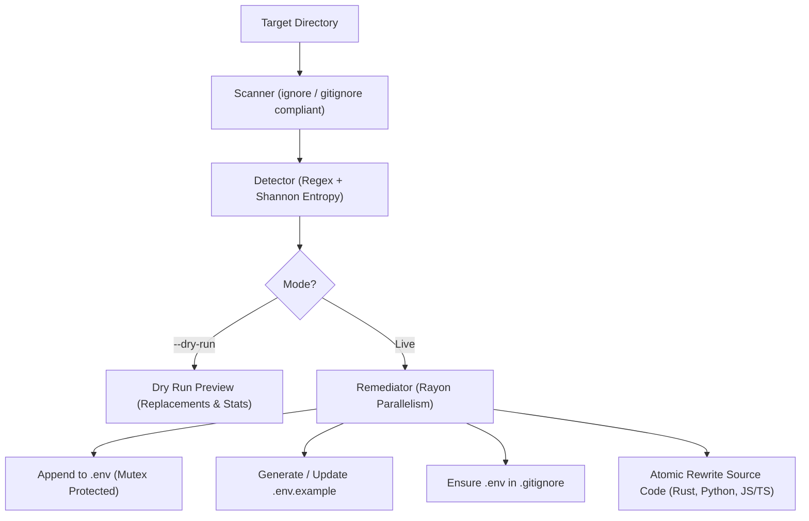

# 🛡️ SecretSentry

[](https://www.rust-lang.org)
[](#license)
[](#built-in-self-test)
[](#)

**SecretSentry** is a fast, concurrent CLI security tool written in Rust. It scans codebases for hardcoded credentials, extracts them into `.env`, auto-generates sanitized `.env.example` templates, secures `.gitignore`, and automatically rewrites source code literals into environment variable lookups.

---

## 🌟 Key Features

- 🔍 **Multi-Provider Secret Detection**: Identifies cloud API keys, OAuth tokens, webhooks, JWTs, and high-entropy strings across 10 pattern providers.
- ⚡ **High-Performance Parallelism**: Concurrent file traversal (`ignore` / `.gitignore` compliant) and multi-threaded file rewriting powered by `rayon`.
- 🔄 **Automatic Source Code Rewriting**: Replaces raw secret literals with language-specific environment variable lookups:
  - **Python**: `os.getenv("KEY")`
  - **JavaScript / TypeScript**: `process.env.KEY`
  - **Rust**: `std::env::var("KEY").unwrap()`
- 📋 **`.env.example` Generation**: Automatically writes or merges placeholder values (e.g., `AWS_ACCESS_KEY_ID=your_aws_access_key_id_here`) for team onboarding.
- 🔒 **`.gitignore` Protection**: Verifies whether `.env` is covered in `.gitignore` and appends it if missing to prevent secret leaks to version control.
- 🧪 **Safe `--dry-run` Mode**: Previews all detected secrets, proposed code replacements, and file actions without altering files on disk.
- 🎨 **ANSI Terminal Formatting**: Clean, colorized findings and banners with automatic Windows VT100 support and `--no-color` / `NO_COLOR` compliance.
- 🛠️ **Integrated Self-Test**: 51-assertion end-to-end sandbox test suite verifiable directly from the CLI via `--self-test`.

---

## 🔎 Supported Secret Detectors

| Provider / Secret Type | Pattern Description | Generated `.env` Key Base |
|---|---|---|
| **AWS Access Key ID** | `AKIA[0-9A-Z]{16}` | `AWS_ACCESS_KEY_ID` |
| **OpenAI API Key** | `sk-[A-Za-z0-9]{32,}` | `OPENAI_API_KEY` |
| **GitHub Token (Classic & Fine-grained)** | `ghp_[0-9A-Za-z]{36}`, `github_pat_[0-9A-Za-z_]{82}` | `GITHUB_TOKEN` |
| **Slack Bot / App Token** | `xox[baprs]-[0-9A-Za-z-]{10,100}` | `SLACK_TOKEN` |
| **Slack Incoming Webhook** | `https://hooks.slack.com/services/...` | `SLACK_WEBHOOK_URL` |
| **Stripe Secret / Restricted Key** | `sk_live_[0-9A-Za-z]{24,}`, `rk_live_[0-9A-Za-z]{24,}` | `STRIPE_SECRET_KEY` |
| **Google Cloud API Key** | `AIza[0-9A-Za-z\\-_]{35}` | `GOOGLE_API_KEY` |
| **Google Cloud Service Account** | `"private_key_id": "[0-9a-f]{40}"` | `GCP_PRIVATE_KEY_ID` |
| **Azure Storage Connection String** | `DefaultEndpointsProtocol=https;AccountName=...` | `AZURE_STORAGE_CONNECTION_STRING` |
| **JSON Web Token (JWT)** | `eyJ...` (base64 header + payload + signature) | `JWT_TOKEN` |
| **High-Entropy Secrets** | Shannon entropy calculation (H ≥ 4.5, len ≥ 20) | `HIGH_ENTROPY_SECRET` |

---

## 🚀 Installation & Setup

### Prerequisites
- [Rust](https://www.rust-lang.org/tools/install) (1.80+ / 2024 edition)
- Cargo package manager

### Build from Source
```bash
# Clone the repository
git clone https://github.com/EkanshTyagi7/SecretSentry.git
cd SecretSentry

# Build optimized release binary
cargo build --release

# The binary will be available at target/release/secretsentry
```

### Install Globally
```bash
cargo install --path .
```

---

## 💻 CLI Usage

```text
SecretSentry

Usage:
  secretsentry <directory> [--dry-run] [--no-color]
  secretsentry --self-test [--no-color]
  secretsentry --help

Options:
  --dry-run    Preview secrets and planned code changes without modifying files or writing .env
  --no-color   Disable ANSI colored terminal output
  --self-test  Run the integrated self-test suite and validation checks
  -h, --help   Print this help message
```

### Examples

#### 1. Preview changes safely with `--dry-run`
Inspect what secrets are found and what code edits would occur without touching any files:
```bash
secretsentry ./my-project --dry-run
```

#### 2. Scan and remediate a codebase
Extracts secrets to `.env`, creates `.env.example`, updates `.gitignore`, and rewrites source files:
```bash
secretsentry ./my-project
```

#### 3. Disable colors (e.g. for CI/CD logging)
```bash
secretsentry ./my-project --no-color
# Or set the environment variable:
NO_COLOR=1 secretsentry ./my-project
```

#### 4. Run the full self-test verification
Runs an isolated sandbox test covering detection, rewriting, `.env` isolation, `.env.example`, and `.gitignore`:
```bash
secretsentry --self-test
```

---

## 🏗️ Architecture



---

## 🧪 Testing

Run unit tests:
```bash
cargo test
```

Run the integrated sandbox test:
```bash
cargo run -- --self-test
```

---

## 📄 License

Dual-licensed under either of:
- Apache License, Version 2.0 ([LICENSE-APACHE](LICENSE-APACHE) or http://www.apache.org/licenses/LICENSE-2.0)
- MIT license ([LICENSE-MIT](LICENSE-MIT) or http://opensource.org/licenses/MIT)

at your option.
